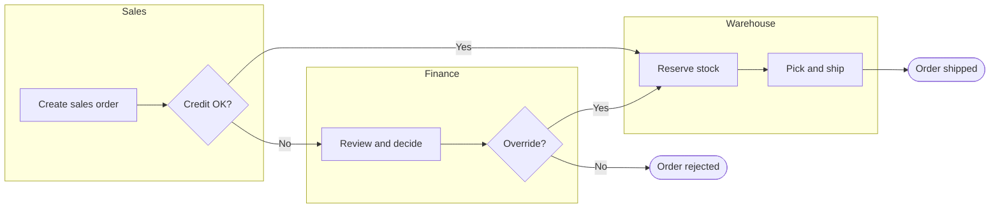
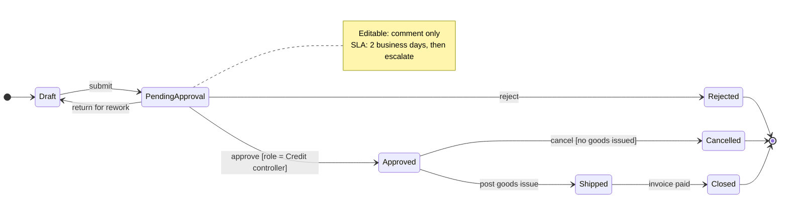
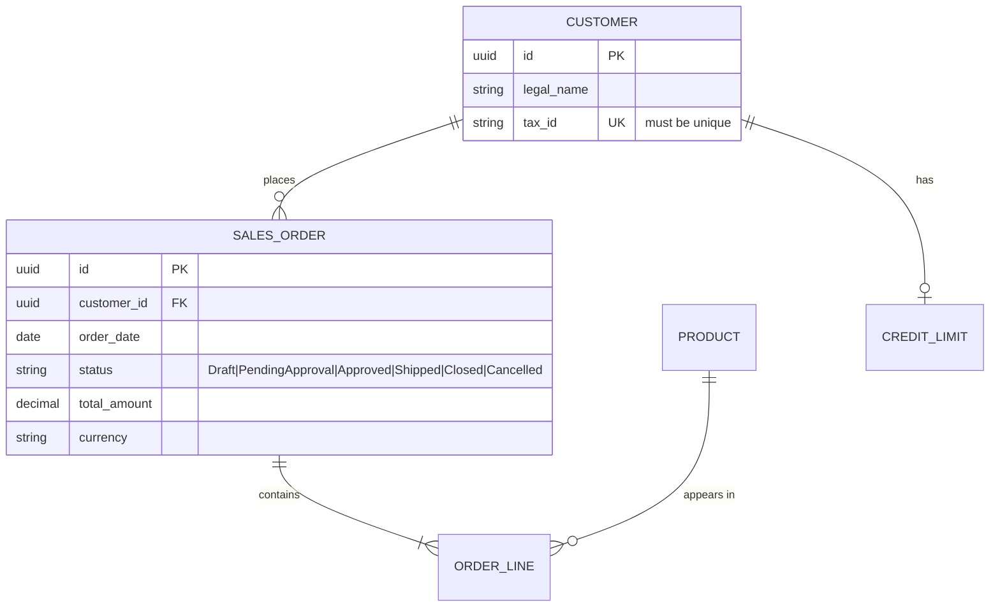
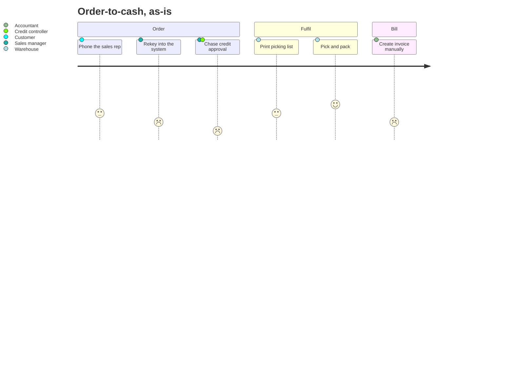

# Process & Data Modeling

Read this when the deliverable is a picture or a structured model: a process diagram, a use case, an entity lifecycle, a decision table, a context diagram, or an AS-IS/TO-BE comparison. A model earns its place when it settles an argument that prose cannot; a decorative diagram costs more than it looks.

## Contents
- AS-IS and TO-BE
- BPMN: the working subset
- BPMN: the eighteen common mistakes
- Use case specification
- Data modeling for analysts
- Decision tables
- CRUD and permissions matrices
- Context diagram and C4
- Mermaid: what renders and how

## AS-IS and TO-BE

Model the current state only as far as the decision needs. A complete AS-IS model of a process you are about to replace is the most common form of wasted analysis effort — but skipping it entirely means designing the future state on hearsay. The useful middle: model AS-IS at the level where the pain actually lives, capture volumes and exception rates while you're there, and stop.

Keep the two diagrams **separate and identically laid out** — same pools, same lanes, same left-to-right order — so a reader can compare them. Mixing current and future state in one diagram, or reorganizing the lanes between them, destroys the comparison that is the whole point.

Between the two sits the **gap**: what has to change in process, data, roles, system and policy. Record gaps in a register rather than as annotations on the diagram; see `1c-erp-analysis.md` for the fit-gap register format used in ERP work.

## BPMN: the working subset

BPMN has over a hundred symbols; an analyst needs about twenty.

**Swimlanes.** A **pool** is one participant — an organization, a party, a system boundary — and one pool holds one process. Sequence flow may not cross a pool boundary. A **black-box (collapsed) pool** is an external party whose internals you deliberately don't model: customer, bank, tax authority. Use these liberally; they remove the temptation to model other people's processes. A **lane** subdivides a pool by role, department or system, and sequence flow does cross lanes. Keep to three to six lanes.

**Activities.** A task with a type marker: **user task** (a person works with the system — the most common in ERP models), **service task** (automated), **manual task** (a person acts without the system — physically picking goods), **script task**, **business rule task** (invokes a decision), **send/receive task**. Plus **sub-process** (collapsed detail), **call activity** (a reusable process invoked here), **event sub-process**, and **transaction**. Markers: loop, multi-instance parallel or sequential, compensation, ad hoc.

**Gateways route; they never do work.**
- **Exclusive (XOR)** — exactly one path. Label the gateway as a question ("Credit OK?") and each outgoing flow as an answer. Conditions must be mutually exclusive and exhaustive, with a default flow.
- **Parallel (AND)** — all paths, unconditionally. A converging AND waits for all.
- **Inclusive (OR)** — one or more, per condition. Subtle merge semantics; use only when you can articulate why several branches may run at once.
- **Event-based** — the process waits and the **first event to occur** decides the path. This is the correct construct for "wait for payment or time out after five days" — not an exclusive gateway.

**Events.** Start (thin border): none, message, timer, conditional, signal. Intermediate (double border), either catching (unfilled marker) or throwing (filled). **Boundary events** attached to an activity's edge are where exception handling actually lives — interrupting (solid: error, deadline, cancel) or non-interrupting (dashed: a reminder timer, an escalation). "If not approved within three days, escalate" is a non-interrupting timer boundary event, not a separate branch. End (thick border): none, message, error, escalation, terminate (which kills all tokens — use deliberately).

**Connections.** Sequence flow is a solid line inside one pool. Message flow is dashed, **between pools only**. Association (dotted) attaches text annotations; data association attaches data objects.

**Data.** A **data object** is a document or record flowing through the process, with its state in brackets: `Order [confirmed]`. A **data store** is persistent storage — the database, or in 1C terms the register.

## BPMN: the eighteen common mistakes

| Mistake | Correct |
|---|---|
| Task named with a noun ("Invoice") | Verb plus object, imperative: "Check credit limit" |
| Event named after its symbol ("Process starts") | Name the state reached: "Order received" |
| Gateway with no question, or labelled like an activity | Label it as a question; label the outgoing flows with the answers |
| Exclusive gateway for work that genuinely happens in parallel | Parallel gateway |
| Inclusive gateway by default | Prefer XOR or AND; use OR only when you can state the multi-branch condition |
| Branches that never converge | Converge with a matching gateway type |
| Sequence flow crossing a pool boundary | Message flow; sequence flow stays inside one pool |
| Message flow between two elements in the same pool | Sequence flow — or they belong in different pools |
| Pools used for internal departments | Departments are lanes; pools are separate participants |
| More than six lanes | Split into sub-diagrams |
| A lane per tool ("1C lane", "CRM lane") | Give a system a lane only when it makes decisions; otherwise it's a service task in a person's lane |
| External parties drawn as expanded pools | Collapse to a black box unless you own their process |
| Paths ending on a task or a gateway | Every path terminates in an end event |
| Missing or implicit start event | Explicit start event, typed where it matters |
| Sub-processes used to hide messy parts | Sub-processes are for cohesive, nameable units of work |
| Exceptions modelled as extra branches off the happy path | Boundary events and event sub-processes |
| One diagram mixing AS-IS and TO-BE | Two diagrams, same lane structure |
| One giant diagram | Level it: value chain → end-to-end process → detailed with exceptions |

## Use case specification

```
UC-<n>  <Active verb phrase naming the actor's goal>

Scope:                the system under design
Level:                Summary | User goal | Subfunction
Primary actor:        whose goal this is
Stakeholders & interests:
    - <stakeholder>: <what they need from this use case>
Preconditions:        true before it starts; not re-checked in the flow
Minimal guarantees:   what the system promises in every outcome, including failure
Success guarantees:   what is true when the goal is achieved
Trigger:              the event that starts it

Main success scenario:
    1. <Actor> <does something>
    2. System <validates / records something>
    3. ...

Extensions:
    2a. <Condition stated as a detected fact>:
        2a1. System <does something>, use case resumes at step 3
    *a. <Condition that can occur at any step>:
        *a1. ...

Technology & data variations:
    1'. Step 1 may be performed via web form | EDI message | mobile app

Related information: frequency · performance target · priority · open issues
```

**Goal levels** — the level is what stops a use case being either useless or unreadable:

| Level | Meaning | Example |
|---|---|---|
| Summary (kite) | A business process spanning several user goals | "Fulfil a customer order" |
| **User goal (sea level)** | One actor, one sitting, one elementary business process — the primary level | "Confirm a sales order" |
| Subfunction (fish) | Supports user goals; not independently valuable | "Find a customer", "Authenticate" |
| Too low (clam) | Implementation detail | "Validate the checksum" |

Two tests for sea level. The **boss test**: would your boss be pleased if you did this all day? ("You did *log in* all day" — no, so it's a fish.) The **elementary business process test**: one person, one place, one time, in response to a business event, adding measurable value and leaving data consistent. And a size test — a user-goal use case has three to nine steps in its main scenario.

**Step-writing rules:** numbered, active voice, subject–verb–object; the subject is an actor or the named system; state intent, not UI mechanics ("the user submits the order", not "the user clicks Submit"); never put an `if` inside a step, because conditions belong in extensions; state extension conditions as **detected facts**, not questions ("4a. The customer's credit limit is exceeded:", not "4a. Is the limit exceeded?"); and end each extension by saying where the flow goes.

Use cases and user stories are not rivals. The use case holds the complete picture with all its alternate paths; stories are slices of work cut from it — main success scenario first, then extensions as separate stories, which is exactly splitting patterns 1 and 4 in `user-stories-and-acceptance.md`.

## Data modeling for analysts

**Conceptual / domain model** — entities and relationships in business language, no keys or types. Its purpose is shared vocabulary. Entity names are singular nouns from the glossary; every relationship carries a named verb phrase readable in both directions ("a Customer *places* zero or more Orders"; "an Order *is placed by* exactly one Customer"); cardinality on both ends; no technical entities.

**Logical model** — adds attributes, keys, types, nullability, uniqueness. This is what feeds a 1C metadata design: it is the document an architect turns into справочники, документы and регистры, so getting the cardinalities right here saves an expensive redesign later.

**Data dictionary**, per attribute: name · business definition · type and length · format · allowed values or reference · mandatory · default · uniqueness · derivation rule · source system · owner · privacy class · retention.

**State machine (entity lifecycle)** — mandatory whenever an entity has a status field. A status field without a state diagram is a bug farm. Model the states, the transitions (named for the events that cause them), the guard condition and the role permitted for each transition, and the terminal states. Then derive from it: which fields are editable in which state, which reports include which states, what happens on cancellation or reversal, and the permission matrix per transition. In 1C terms this is also where you decide what unposting and re-posting must do.

## Decision tables

```
                        | R1  | R2  | R3  | R4  | R5  | R6  |
CONDITIONS              |-----|-----|-----|-----|-----|-----|
  Customer type         | New | New | Reg | Reg | Reg | VIP |
  Order total ≥ 1000    |  N  |  Y  |  N  |  Y  |  -  |  -  |
  Has overdue invoices  |  -  |  -  |  N  |  N  |  Y  |  -  |
------------------------|-----|-----|-----|-----|-----|-----|
ACTIONS                 |     |     |     |     |     |     |
  Discount %            |  0  |  3  |  5  |  8  |  0  | 12  |
  Requires approval     |  N  |  Y  |  N  |  N  |  Y  |  N  |
  Free shipping         |  N  |  N  |  N  |  Y  |  N  |  Y  |
```

`Y` / `N` / `-` for don't-care. **Completeness check:** with conditions of arity a₁…aₙ there are Πaᵢ combinations — 2ⁿ when every condition is binary, but note the table above has a three-valued condition, so its space is 3×2×2 = 12. Each `-` multiplies a rule's coverage by that condition's arity. If the covered count doesn't reach the total you have a gap — and that gap is usually where the production defect will be. R6 above exists only because the first draft of this table had no rule for a registered customer *with* overdue invoices, which is exactly the kind of hole the count finds. Also check for **contradictions** (same conditions, different actions) and **redundancy** (identical actions that could merge).

Use a table instead of prose when two or more conditions combine to decide an outcome — pricing, discounts, tax, eligibility, routing, approval thresholds, commission, penalties, which is most of the interesting logic in an ERP. Three more reasons: it forces the business to discover whether they actually have a consistent rule; **each column is a free test case**; and when the rule changes often, the table is the change surface.

Use prose or a decision *tree* instead when conditions are evaluated in order with early exit, when there's only one condition, or when the logic is a calculation rather than a classification — then write the formula. Past about five conditions, factor out a sub-decision rather than growing one giant table.

## CRUD and permissions matrices

A **CRUD matrix** puts entities against processes (or against roles) with C/R/U/D in the cells. It catches things prose never does:

- An entity **read but never created** → a missing process, or an external source you forgot.
- An entity **created but never read** → dead data, or a missing report.
- An entity with **no D and no archival rule** → a retention gap.
- An entity **updated by many processes** → concurrency, locking and audit questions. In 1C this is precisely the question "who writes to this register?", and getting it wrong produces the hardest class of production bug.
- A role with **U or D on everything** → an access-control smell.

The role-oriented variant is the **roles and permissions matrix**: identify roles → identify activities → identify authorities. Use CRUD for data and RACI for activities; together they are the security section of a specification, and they are far more reviewable than the same content in sentences.

## Context diagram and C4

A **context diagram** — one bubble for the system, external entities around it, named flows in and out — is cheap, fast, and the single best tool for a scope conversation, because everyone can read it.

**C4** formalizes the same idea as zoom levels: **level 1 system context** (your system as one box, the people and the other systems it touches, no technology) · **level 2 container** (the separately deployable things inside — web app, API, database, message broker — with technology and how they communicate) · level 3 component · level 4 code.

For an analyst, levels 1 and 2 are the payload. Level 1 replaces the context diagram in a specification and settles the scope argument. Level 2 is the integration conversation: which containers exist, which talk to which, over what protocol, synchronously or not — and **every arrow at level 2 should end up as an entry in the interface inventory**, with its data contract, direction, trigger, frequency, and behaviour on failure. Interfaces are the single most under-specified area of ERP projects, and an unlisted interface is a schedule risk nobody has priced.

Every element needs a name, a type, a technology (from level 2 down) and a short description; every relationship needs a label describing the intent and, from level 2, the protocol. Arrows point in the direction of dependency, and should read as a sentence: `Sales manager → [confirms orders using, HTTPS] → Order web app`.

## Mermaid: what renders and how

| Artifact | Mermaid | Verdict |
|---|---|---|
| Flowchart / simple process | `flowchart` | Excellent; use `subgraph` for pseudo-swimlanes |
| BPMN | — | Not supported. Approximate with a flowchart, or produce proper BPMN in a modeler |
| Sequence / integration flow | `sequenceDiagram` | Best-in-class |
| Entity lifecycle | `stateDiagram-v2` | Excellent |
| Domain model / ERD | `erDiagram` | Very good |
| Class model | `classDiagram` | Good |
| Customer journey | `journey` | Simple but useful for pain mapping |
| C4 context/container | `C4Context` | Experimental, unreliable layout — a flowchart with subgraphs is more predictable |
| Requirements diagram | `requirementDiagram` | Rarely worth it — a traceability table is better |
| Rough plan | `gantt` | Fine |

**Process with pseudo-swimlanes:**

Shapes: `[rect]` process · `([stadium])` start/end · `{rhombus}` decision · `[(cylinder)]` store. Links: `-->` · `-.->` · `==>` · `-- label -->`.

**Integration flow:**
```mermaid
sequenceDiagram
    autonumber
    actor M as Sales manager
    participant UI as 1C client
    participant SRV as 1C server
    participant BANK as Bank API
    M->>UI: Confirm order
    UI->>+SRV: ConfirmOrder(orderId)
    SRV->>SRV: Check credit limit
    alt Limit exceeded
        SRV-->>-UI: Rejected (shortfall 3 000 GEL)
        UI-->>M: Show block message
    else Within limit
        SRV->>+BANK: ReserveFunds(orderId, amount)
        BANK-->>-SRV: reservationId
        SRV->>SRV: Post reservation to register
        SRV-->>-UI: Confirmed
    end
    Note over SRV,BANK: Timeout 5 s, then queue for retry
```
Arrows: `->>` call · `-->>` return · `-x` failure · `-)` async. Blocks: `alt/else`, `opt`, `loop`, `par/and`, `break`.

**Entity lifecycle:**


**Domain model:**

Cardinality markers: `|o`/`o|` zero-or-one · `||` exactly one · `}o`/`o{` zero-or-more · `}|`/`|{` one-or-more. Keys: `PK`, `FK`, `UK`.

**Current-state pain map:**

Score each step 1–5. The low scores *are* the improvement backlog — which makes this the fastest way to turn an interview into a prioritized list.

**Georgian labels render fine in Mermaid.** Put node text in Georgian when the audience is the business, and keep the canonical Russian or English system term alongside where it names a 1C object, so a developer reading the same diagram knows exactly which object is meant.
